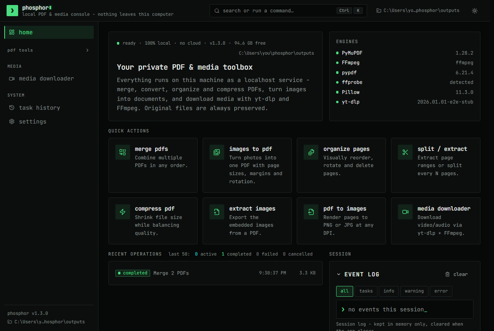
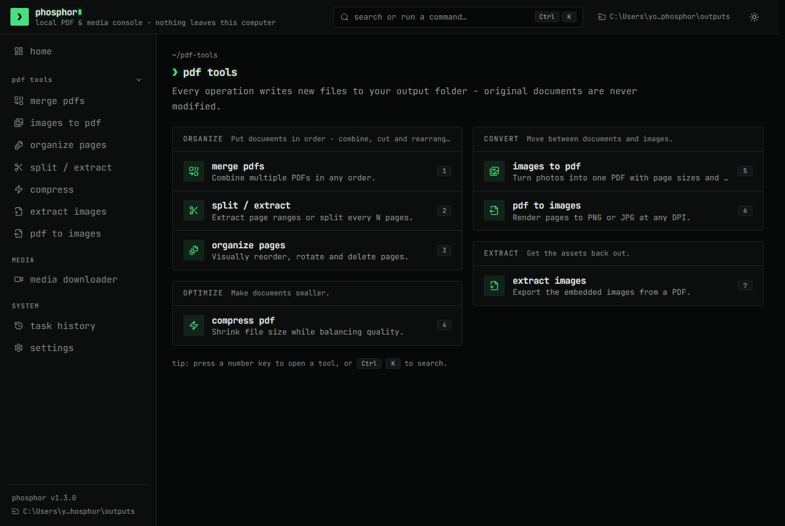
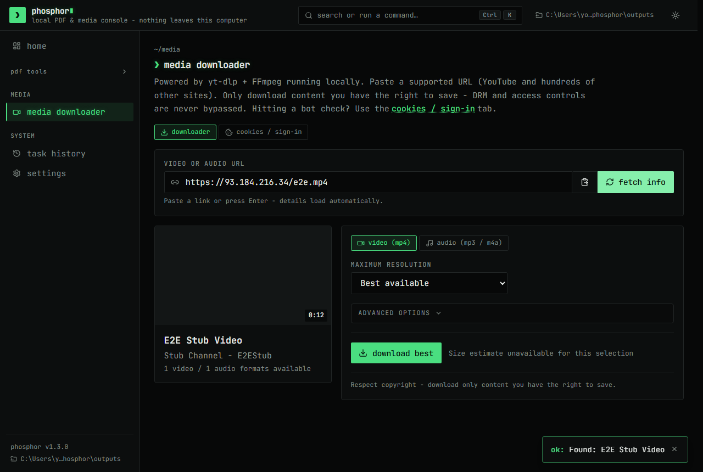
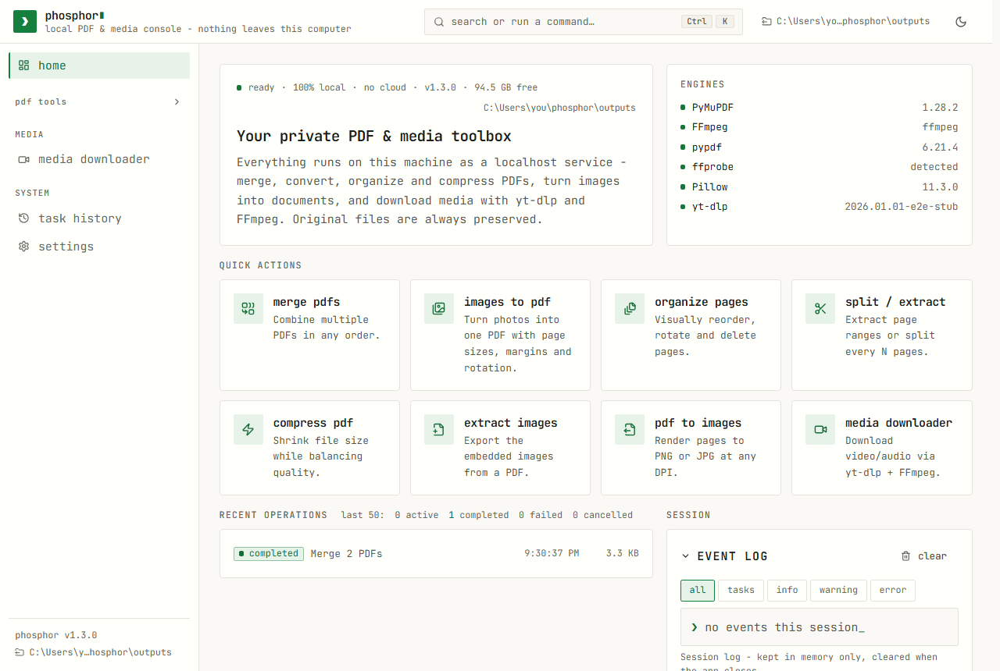

# phosphor

A local-first **PDF toolbox + media console** for your own machine.
Merge, split, compress and convert PDFs, and download video/audio through
yt-dlp — everything processed locally, nothing sent to a cloud.



## Features

**PDF tools** (originals are never modified — every operation writes new files):

- **Merge** multiple PDFs · **Split / Extract** pages or ranges
- **Organize pages** visually (reorder, rotate, delete)
- **Compress** (real output-size reporting; keeps the original if it can't shrink)
- **Images to PDF** and **PDF to Images** (PNG/JPG, any DPI)
- **Extract images** embedded in a PDF

**Media downloader** (powered by yt-dlp + FFmpeg):

- Paste a URL → title, thumbnail, duration and all available formats
- MP4 video or MP3/M4A audio, resolution presets, live progress with speed/ETA
- Cancel anytime; partial files are cleaned up automatically
- **Cookies / Sign-in** tab for YouTube's bot check (your own session)

**Everything else:**

- Task queue with progress, cancellation and re-downloadable history; a global **task tray** in the header follows running tasks from any page
- Dark (default) and light themes, accent presets (green / amber / ice) and an optional CRT effect (Settings → Appearance)
- `Ctrl+K` command palette, keyboard-friendly
- No accounts, no telemetry, no cloud — files never leave this computer

| PDF Tools | Media Downloader |
|---|---|
|  |  |
| **Home (light theme)** | |
|  | |

## Requirements

| | |
|---|---|
| OS | Windows 10/11 (primary), Linux, macOS |
| Python | 3.10+ |
| FFmpeg | optional — needed for media conversion/merging, not for PDF tools |
| Node.js | optional — only to rebuild the UI or run E2E tests |

## Quick start (Windows)

1. Install [Python](https://www.python.org/downloads/) — check **"Add python.exe to PATH"**.
2. Optional: install FFmpeg → `winget install Gyan.FFmpeg`
3. Double-click **`scripts\start.bat`** — first run creates the environment and opens `http://127.0.0.1:8756`.

**Linux / macOS:** `./scripts/start.sh` (FFmpeg via your package manager).

`scripts\setup.bat` does setup only; `scripts\stop.bat` stops the app and kills
running downloads.

## YouTube sign-in (cookies)

YouTube often answers anonymous automated requests with *"Sign in to confirm
you're not a bot"*. The fix is the app's **Media Downloader → Cookies /
Sign-in** tab: it sends the cookies of **your own logged-in browser session**
(the officially supported yt-dlp mechanism — you are just authenticated as
yourself).

1. Log in to youtube.com, export the site's cookies with an extension
   ("Get cookies.txt LOCALLY"), or copy the `Cookie:` header line from devtools.
2. Paste into the Cookies tab and save — or pick **browser cookies** mode
   (close that browser fully first).
3. **Test sign-in** verifies it.

Cookies are stored only in `data/cookies.txt`, never logged and never shown.
Treat that file like a password; use **Clear cookies** before sharing the folder.

## Configuration

`config.json` is created with defaults on first start. Most settings can also
be edited live in **Settings** (host/port need a restart):

| Key | Default | |
|---|---|---|
| `host` / `port` | `127.0.0.1` / `8756` | keep localhost unless you understand the risk |
| `output_dir` | `outputs/` | where results and downloads go |
| `max_upload_mb` / `max_download_gb` / `max_duration_hours` | `512` / `2` / `4` | safety limits (0 = no cap) |
| `ffmpeg_path` / `ytdlp_path` | auto-detect | set if the tools are not on PATH |
| `history_limit` | `100` | task history entries kept |
| `cookie_source` / `cookie_browser` | — | set from the Cookies tab, not by hand |

## Privacy & security

- Binds to `127.0.0.1` by default; LAN exposure is an explicit opt-in (Settings → Network) with warnings.
- Cross-site requests are blocked; URLs pointing at private/loopback addresses are rejected (SSRF protection).
- Uploads are content-sniffed, all paths validated; config/history writes are atomic.
- Cookie values never appear in API responses or logs.

## Testing

```bat
.venv\Scripts\python.exe -m pytest      :: backend (~106 tests)
cd frontend && npm run build            :: type-check + production build
cd frontend && npm run e2e              :: Playwright, real browser (35 tests, offline)
```

E2E details: [frontend/e2e/README.md](frontend/e2e/README.md).

```bat
cd frontend && npm run shots            :: screenshot harness -> frontend/e2e/.shots/ (not part of e2e)
cd frontend && npm run format           :: Prettier (format:check to verify)
```

## Known limitations

- Private/members-only/DRM-protected content is never downloaded — cookies only
  authenticate *your* access, they bypass nothing.
- Compression targets raster images; text-only PDFs may shrink little (the app
  keeps the original and says so).
- Image extraction exports raster images only; no OCR, forms or annotations.
- Playlists are limited to their first entry; cookies are stored in plain text
  (the format yt-dlp requires) with ACL hardening on Windows.

## Troubleshooting

| Problem | Fix |
|---|---|
| "FFmpeg was not found" | `winget install Gyan.FFmpeg`, restart the app, or set the path in Settings |
| YouTube: "sign-in / bot verification" | Cookies / Sign-in tab — see above |
| Cookies worked, now failing | Sessions expire — re-export fresh cookies |
| Port already in use | `scripts\stop.bat`, or change `port` in `config.json` |
| UI shows "API running" | Rebuild the UI: `cd frontend && npm install && npm run build`, restart |
| Download fails mid-way | Check the task's diagnostics log and `data/logs/app.log` |

## License

MIT — see [LICENSE](LICENSE). PyMuPDF is AGPL-3.0 (fine for local personal use).
Downloading media may be illegal depending on content and jurisdiction; you are
responsible for complying with site terms and copyright law.
